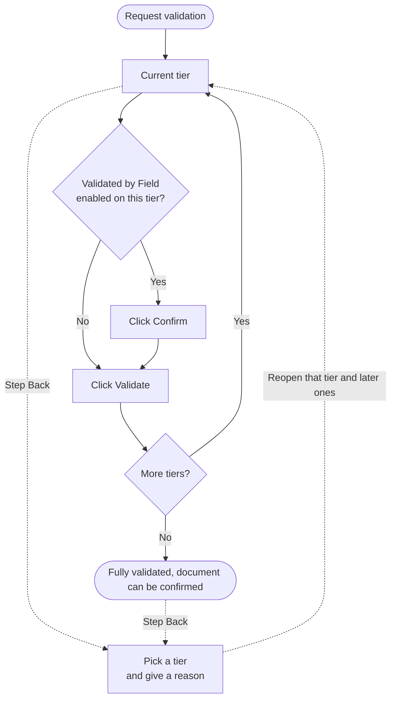
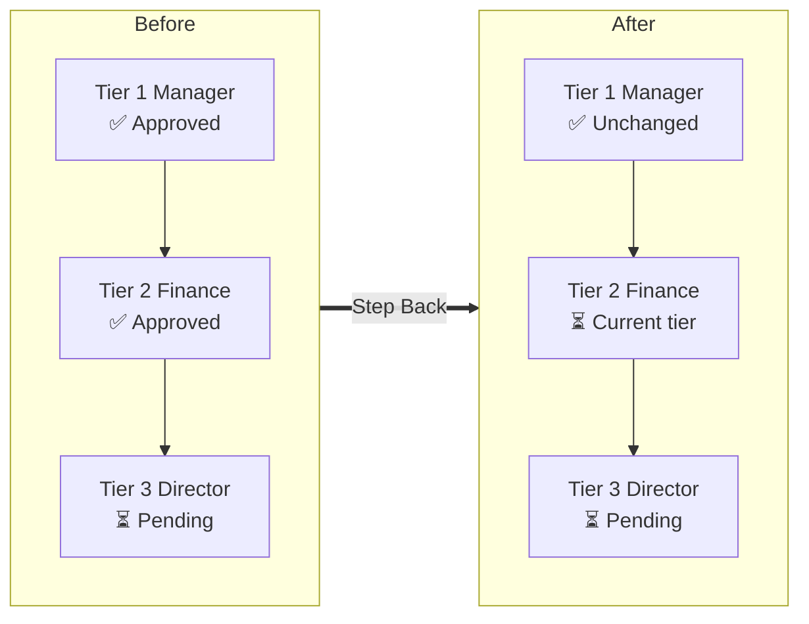
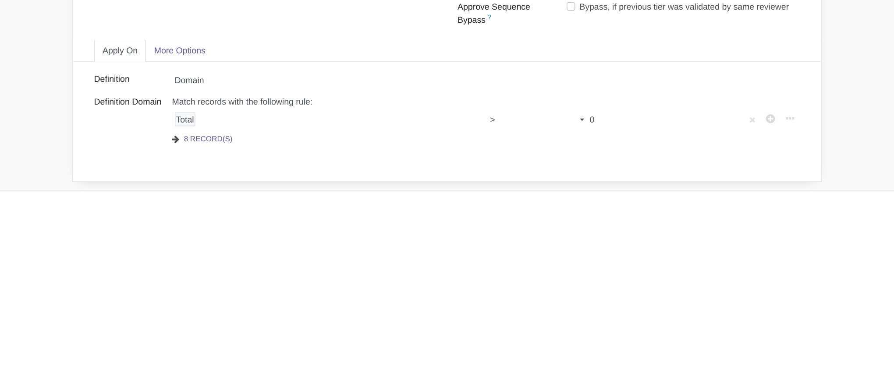
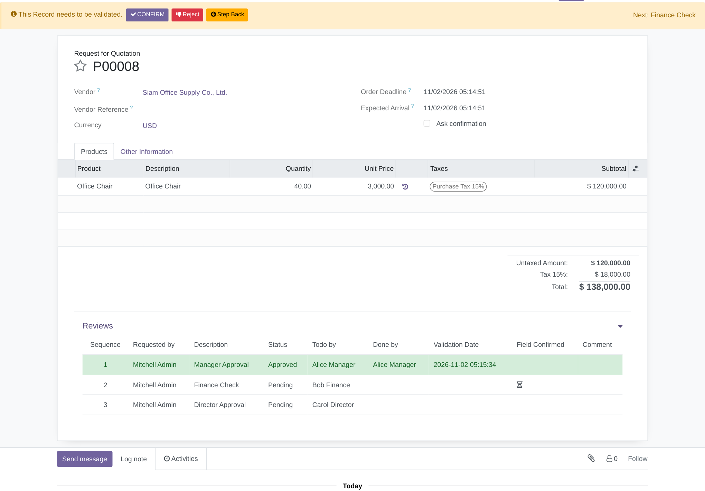
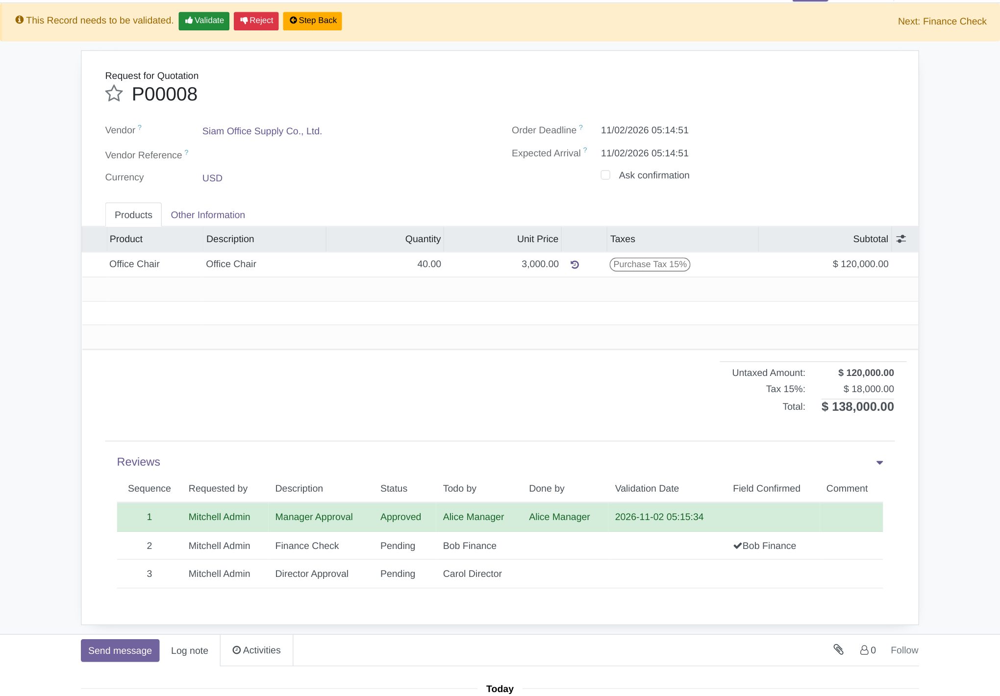
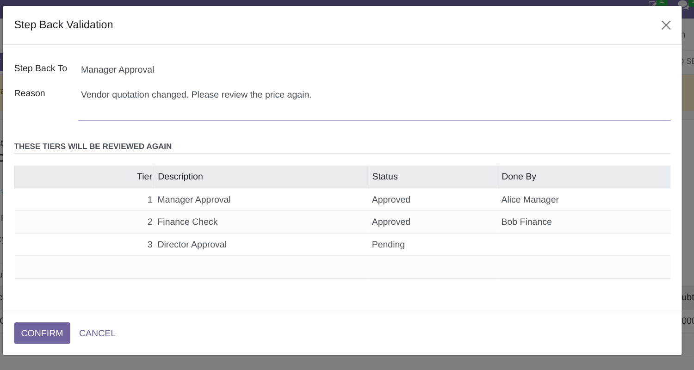
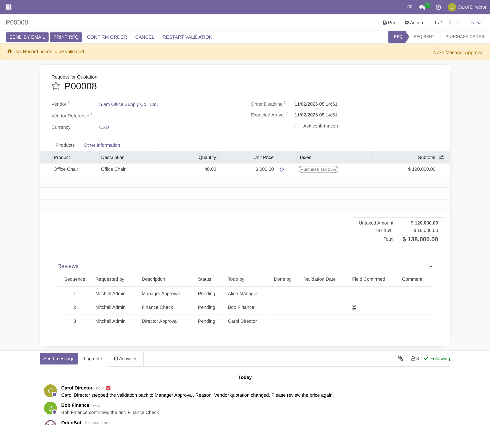

# Base Tier Validation Step

[ภาษาไทย](README.md) | **English**

An Odoo 16 add-on that extends OCA's [`base_tier_validation`](https://github.com/OCA/server-ux/tree/16.0/base_tier_validation) (multi-tier document approval). It works with any document that supports tier validation, such as purchase orders through `purchase_tier_validation`.

| Feature | What it does | Why you need it |
| --- | --- | --- |
| **Step Back** | Sends a document back to a tier that was already reviewed, with a recorded reason | Otherwise a mistake found midway means Restart Validation and approving every tier again |
| **Validated by Field** | Makes selected tiers require a **Confirm** click before the **Validate** button appears | Prevents approving without the check, for example Finance verifying the budget first |

Demo video: <https://youtu.be/dmNs2tVef_Y>

## How it works



### What Step Back changes

Example: Carol (tier 3) steps the document back to tier 2.



The selected tier and every later tier return to **Pending**, clearing the reviewer, date, comment and confirmation. Earlier tiers stay as they are, and the reason is posted to the document's chatter.

## Installation

**Requirements:** Odoo 16.0 and `base_tier_validation` from [OCA/server-ux](https://github.com/OCA/server-ux/tree/16.0).

```bash
git clone https://github.com/madara1150/base_tier_validation_step
```

1. Add the cloned folder to your `addons_path`.
2. Enable Developer Mode and go to **Apps → Update Apps List**.
3. Search for `Base Tier Validation Step` and click **Activate**.

> If your document does not support tier validation yet, also install the matching OCA module, such as `purchase_tier_validation`.

## Configuration

Go to **Settings → Technical → Tier Validations → Tier Definition**, open a tier and tick **Validated by Field**.



Combine it with **Approve by sequence** to enforce the tier order, and with **Notify Reviewers on Restarted** (More Options tab) to notify reviewers when a document is stepped back.

## Usage

### 1. Confirm before validating

When a tier with Validated by Field is reached, the reviewer sees **Confirm** instead of **Validate**, and the Reviews table shows an hourglass.



After Confirm, **Validate** appears, the Reviews table shows who confirmed, and the chatter records it.



### 2. Step back

Click **Step Back** on the banner above the document, pick the tier to return to and enter a reason. The dialog lists the tiers that will need a new review before you confirm.



The document returns to the reviewer of the selected tier, and the reason is recorded in the chatter.



### Who can step back

The Step Back button appears while the document is still in its initial state (RFQ for a purchase order) and at least one tier has been approved or rejected. The user must be one of:

- the reviewer whose turn it is
- someone who already approved or rejected a tier of this document
- a member of the **Tier Validation: Step Back Any Document** group (administrators have it automatically)

Rejected and fully validated documents can be stepped back. Documents already confirmed (for example, turned into a Purchase Order) cannot.

## For developers

### Calling it from another module

| Method on `tier.validation` | Purpose |
| --- | --- |
| `confirm_by_field()` | Confirms the current user's tiers that are due; raises `UserError` when there is nothing to confirm |
| `step_tier_validation()` | Opens the Step Back dialog |
| `_step_back_to(review, reason)` | Steps back directly, checking permission and document state |
| `_user_can_step_back()` | Override to change who may step back |
| `_get_step_back_reviews()` | Override to change which tiers can be returned to |

The confirmation is enforced on the server in `_validate_tier()`, so it also applies to RPC calls and the comment wizard.

### Hand-written forms

Documents with `_tier_validation_manual_config = False` get all the buttons automatically. With `True`, add the `confirm_by_field` and `step_tier_validation` buttons, plus the `validated_by_field`, `validated_field` and `can_step_back` fields, to the form yourself.

### Running the tests

The tests need a database with demo data and the `odoo-test-helper` library.

```bash
pip install odoo-test-helper
```

```bash
odoo -d test_db -i base_tier_validation_step --test-enable --test-tags /base_tier_validation_step --stop-after-init
```

## Upgrading from 16.0.1.0.0

- Confirmations are now stored per tier on `tier.review`, and `validated_field` is no longer stored. Documents waiting on a confirmation tier must be confirmed again.
- Step Back is no longer shown to everyone. See [Who can step back](#who-can-step-back).
- A reason is now mandatory when stepping back.

## License

[LGPL-3](https://www.gnu.org/licenses/lgpl-3.0.html). Developed by Aginix Technologies.
