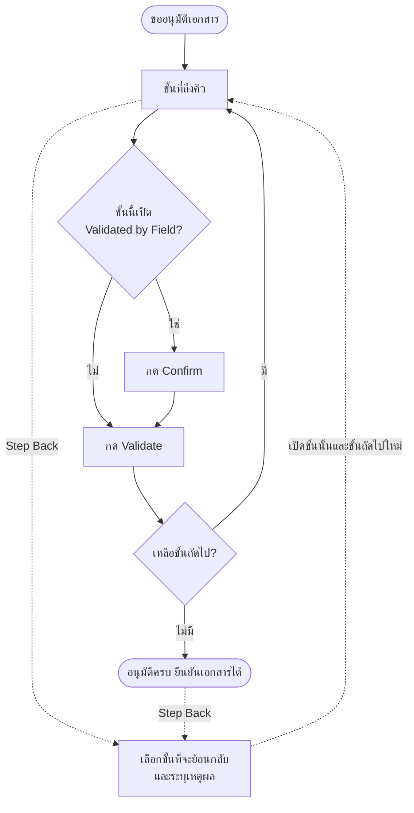
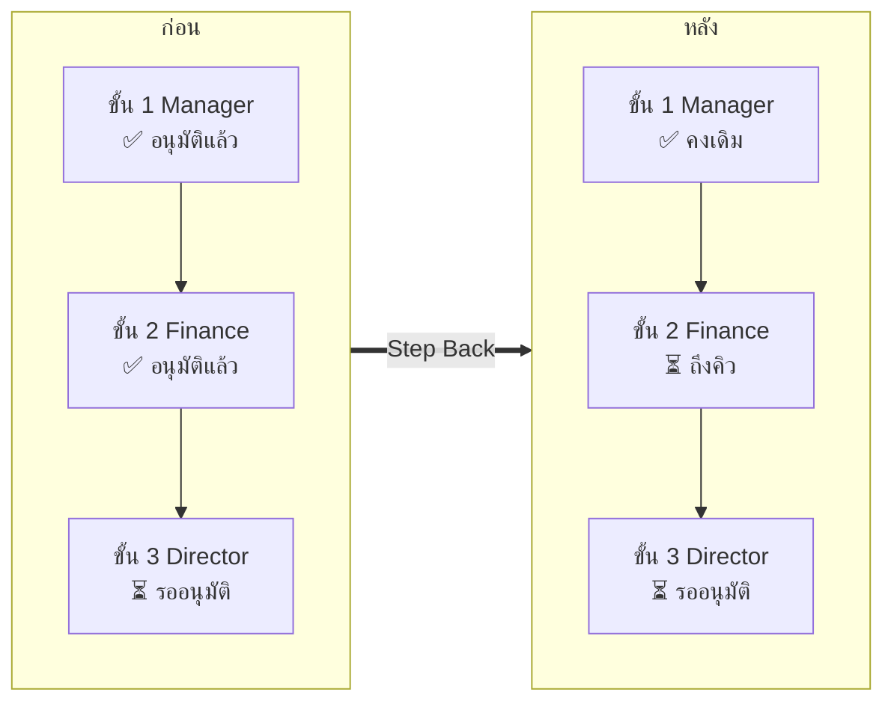
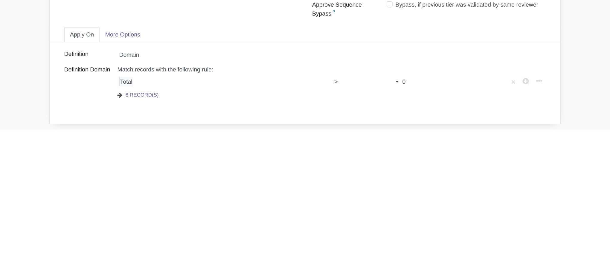
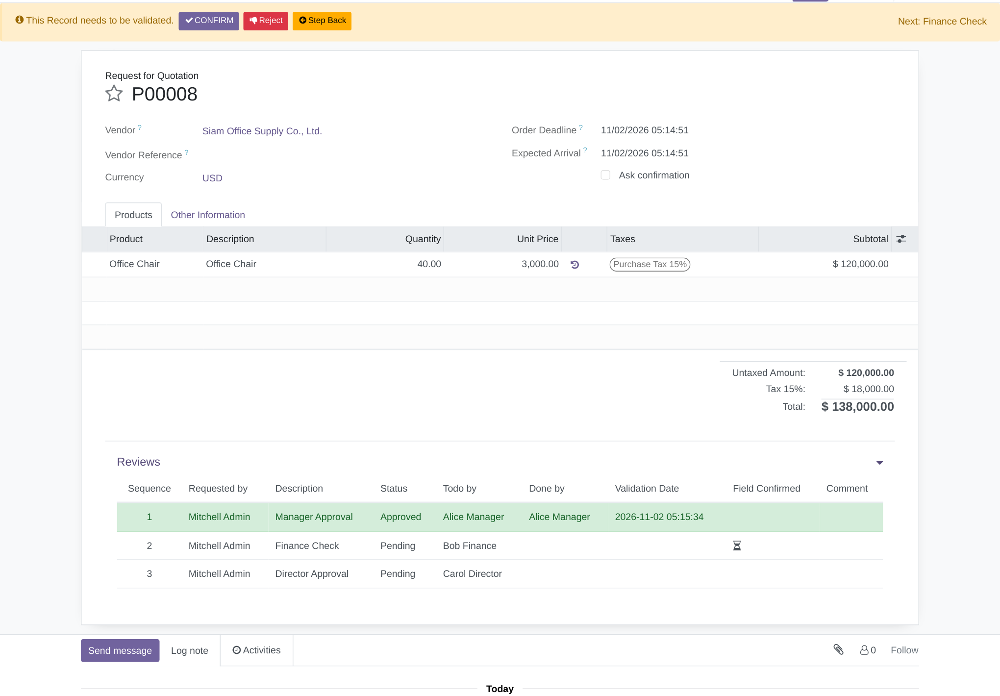
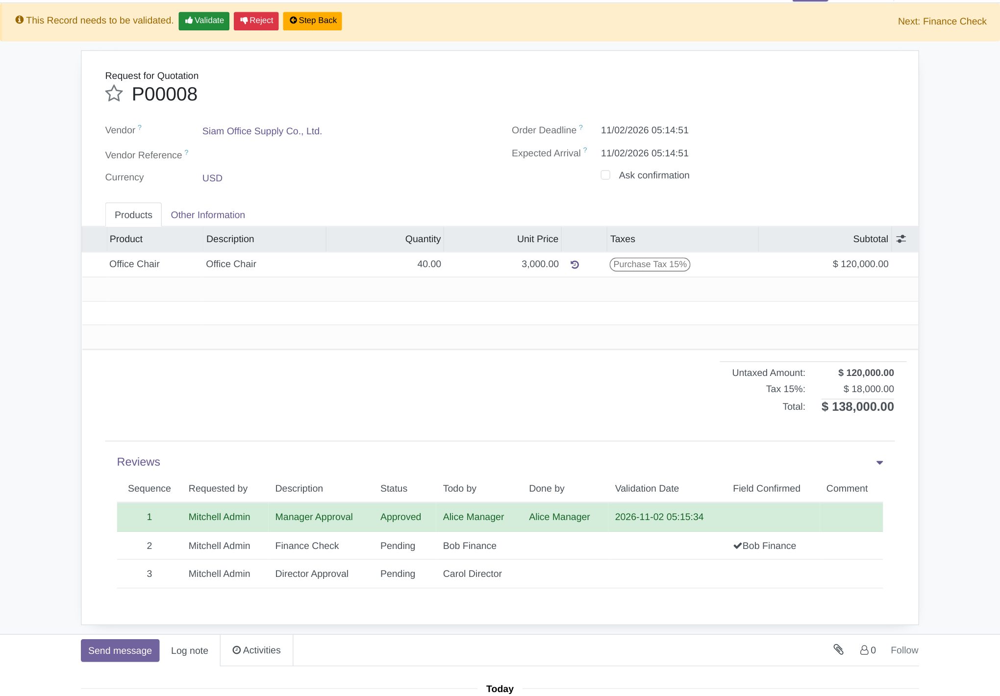
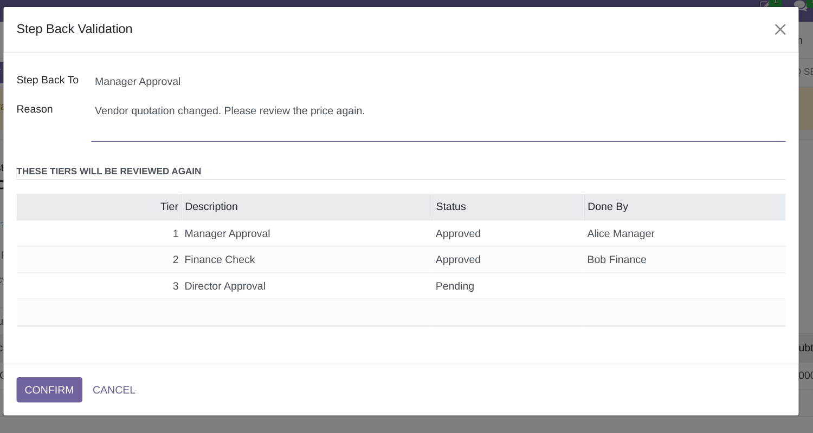
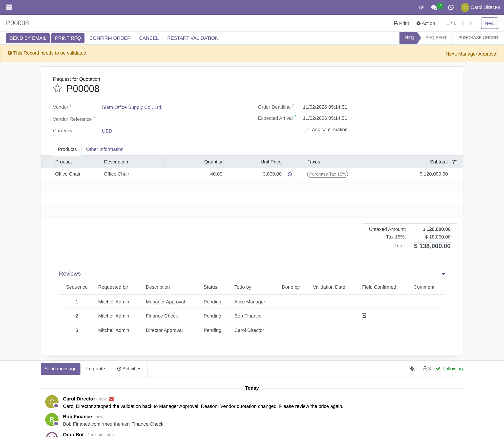

# Base Tier Validation Step

**ภาษาไทย** | [English](README.en.md)

โมดูลเสริมสำหรับ Odoo 16 ที่เพิ่มความสามารถให้ [`base_tier_validation`](https://github.com/OCA/server-ux/tree/16.0/base_tier_validation) ของ OCA (ระบบอนุมัติเอกสารหลายขั้น) ใช้ได้กับทุกเอกสารที่รองรับ tier validation เช่น ใบสั่งซื้อ (`purchase_tier_validation`)

| ความสามารถ | ทำอะไร | แก้ปัญหาอะไร |
| --- | --- | --- |
| **Step Back** (ย้อนขั้น) | ส่งเอกสารกลับไปยังขั้นที่อนุมัติไปแล้ว พร้อมบันทึกเหตุผล | เดิมถ้าพบข้อผิดพลาดกลางทางต้อง Restart Validation แล้วเริ่มอนุมัติใหม่ทุกขั้น |
| **Validated by Field** (ยืนยันก่อนอนุมัติ) | กำหนดให้บางขั้นต้องกด **Confirm** ก่อน ปุ่ม **Validate** จึงจะแสดง | ป้องกันการอนุมัติข้ามขั้นตอนตรวจสอบ เช่น ฝ่ายการเงินต้องตรวจงบก่อน |

วิดีโอสาธิต: <https://youtu.be/dmNs2tVef_Y>

## ภาพรวมการทำงาน



### Step Back เปลี่ยนอะไรบ้าง

ตัวอย่าง: Carol (ขั้น 3) ย้อนเอกสารกลับไปที่ขั้น 2



ขั้นที่เลือกและทุกขั้นหลังจากนั้นจะกลับเป็น **Pending** โดยล้างผู้อนุมัติ วันที่ ความเห็น และการ Confirm ส่วนขั้นก่อนหน้าไม่เปลี่ยนแปลง และระบบจะบันทึกเหตุผลลง chatter ของเอกสาร

## การติดตั้ง

**สิ่งที่ต้องมี:** Odoo 16.0 และโมดูล `base_tier_validation` จาก [OCA/server-ux](https://github.com/OCA/server-ux/tree/16.0)

```bash
git clone https://github.com/madara1150/base_tier_validation_step
```

1. เพิ่มโฟลเดอร์ที่ clone มาใน `addons_path`
2. เปิด Developer Mode แล้วไปที่ **Apps → Update Apps List**
3. ค้นหา `Base Tier Validation Step` แล้วกด **Activate**

> หากเอกสารของคุณยังไม่รองรับ tier validation ให้ติดตั้งโมดูลเชื่อมต่อของ OCA เพิ่ม เช่น `purchase_tier_validation`

## การตั้งค่า

ไปที่ **Settings → Technical → Tier Validations → Tier Definition** เปิดขั้นที่ต้องการ แล้วติ๊ก **Validated by Field**



ใช้ร่วมกับ **Approve by sequence** เพื่อให้อนุมัติเรียงตามลำดับ และ **Notify Reviewers on Restarted** (แท็บ More Options) เพื่อแจ้งผู้อนุมัติเมื่อมีการย้อนขั้น

## วิธีใช้งาน

### 1. ยืนยันก่อนอนุมัติ

เมื่อถึงคิวของขั้นที่เปิด Validated by Field ผู้อนุมัติจะเห็นปุ่ม **Confirm** แทน **Validate** และในตาราง Reviews จะแสดงไอคอนนาฬิกาทราย



หลังกด Confirm ปุ่ม **Validate** จะแสดงขึ้น ตาราง Reviews จะแสดงชื่อผู้ยืนยัน และ chatter จะบันทึกการยืนยันไว้



### 2. ย้อนขั้น

กด **Step Back** บนแถบแจ้งเตือนด้านบนเอกสาร เลือกขั้นที่จะย้อนกลับ แล้วระบุเหตุผล หน้าต่างจะแสดงรายการขั้นที่จะต้องอนุมัติใหม่ก่อนกด Confirm



เอกสารจะกลับไปรอผู้อนุมัติของขั้นที่เลือก พร้อมบันทึกเหตุผลใน chatter



### ใครย้อนขั้นได้บ้าง

ปุ่ม Step Back แสดงเมื่อเอกสารยังอยู่ในสถานะเริ่มต้น (เช่น RFQ สำหรับใบสั่งซื้อ) และมีขั้นที่ถูกอนุมัติหรือปฏิเสธแล้ว โดยผู้ใช้ต้องเป็นอย่างใดอย่างหนึ่งต่อไปนี้

- ผู้อนุมัติของขั้นที่ถึงคิวอยู่ตอนนี้
- ผู้ที่อนุมัติหรือปฏิเสธขั้นใดขั้นหนึ่งของเอกสารนี้ไปแล้ว
- สมาชิกกลุ่ม **Tier Validation: Step Back Any Document** (ผู้ดูแลระบบได้สิทธิ์นี้โดยอัตโนมัติ)

เอกสารที่ถูกปฏิเสธหรืออนุมัติครบแล้วก็ย้อนขั้นได้ แต่เอกสารที่ยืนยันไปแล้ว (เช่น เป็น Purchase Order แล้ว) จะย้อนไม่ได้

## สำหรับนักพัฒนา

### เรียกใช้จากโมดูลอื่น

| เมธอดบน `tier.validation` | หน้าที่ |
| --- | --- |
| `confirm_by_field()` | ยืนยันขั้นที่ถึงคิวของผู้ใช้ปัจจุบัน ถ้าไม่มีรายการให้ยืนยันจะแจ้ง `UserError` |
| `step_tier_validation()` | เปิดหน้าต่าง Step Back |
| `_step_back_to(review, reason)` | ย้อนขั้นโดยตรง พร้อมตรวจสิทธิ์และสถานะเอกสาร |
| `_user_can_step_back()` | override เพื่อเปลี่ยนเงื่อนไขสิทธิ์การย้อนขั้น |
| `_get_step_back_reviews()` | override เพื่อเปลี่ยนรายการขั้นที่ย้อนกลับได้ |

เงื่อนไขการยืนยันตรวจที่ฝั่งเซิร์ฟเวอร์ใน `_validate_tier()` จึงมีผลกับการเรียกผ่าน RPC และ Comment wizard ด้วย

### เอกสารที่เขียนฟอร์มเอง

เอกสารที่ตั้ง `_tier_validation_manual_config = False` จะได้ปุ่มทั้งหมดอัตโนมัติ ถ้าใช้ `True` ให้เพิ่มปุ่ม `confirm_by_field` และ `step_tier_validation` พร้อมฟิลด์ `validated_by_field`, `validated_field`, `can_step_back` ลงในฟอร์มเอง

### การรันเทสต์

ต้องใช้ฐานข้อมูลที่มี demo data และไลบรารี `odoo-test-helper`

```bash
pip install odoo-test-helper
```

```bash
odoo -d test_db -i base_tier_validation_step --test-enable --test-tags /base_tier_validation_step --stop-after-init
```

## การอัปเกรดจาก 16.0.1.0.0

- การ Confirm ย้ายไปเก็บต่อขั้นใน `tier.review` และ `validated_field` ไม่ได้เก็บในฐานข้อมูลแล้ว เอกสารที่ค้างอยู่ในขั้นที่ต้องยืนยันจะต้องกด Confirm ใหม่อีกครั้ง
- ปุ่ม Step Back ไม่ได้แสดงให้ทุกคนอีกต่อไป ดูเงื่อนไขที่หัวข้อ [ใครย้อนขั้นได้บ้าง](#ใครย้อนขั้นได้บ้าง)
- ต้องระบุเหตุผลทุกครั้งที่ย้อนขั้น

## License

[LGPL-3](https://www.gnu.org/licenses/lgpl-3.0.html) พัฒนาโดย Aginix Technologies
